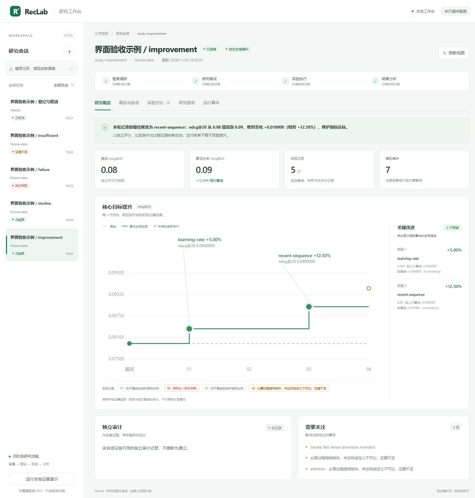

# RecLab Agent

一个面向推荐模型优化的研究 Agent：在固定数据、评估协议与资源预算下，读取源码、提出可检验假设、修改代码、运行实验，并根据独立验证集评分决定保留、否定或补充证据。

**研究流程：背景 → 假设 → 实验 → 分析。** 默认使用一个固定随机种子；历史基线通过身份与评分核验后可以复用，无需每次重新训练。

## 核心能力

- **工具化研究闭环**：源码读写、语法检查、Smoke Test、训练、预测、日志与独立评分由宿主工具执行，模型只能使用当前阶段授权的工具。
- **主研究者 + 独立审计**：两个会话隔离上下文与权限。审计者只读冻结证据，先独立判断再核查研究结论；审计通过不能替代独立评分。默认仍为单 Agent。
- **可追溯实验与经验记忆**：源码快照、本地 Git、SQLite 实验账本和 Markdown 经验摘要；默认用 BM25 检索历史经验，数值结论回读原始评分。
- **研究工作台**：查看真实会话、指标提升图、关键改进、代码差异、评分证据、审计结果和事件流；CLI 与 Web 共用状态。
- **有界执行与恢复**：记录请求、补丁与训练用量；失败请求保留额度消耗；工具副作用不明时要求核验，不盲目重放。Trace 关联研究、阶段、角色、请求与实验身份。



*截图使用隔离的界面验收示例，不代表真实模型收益。图中只有已核验、可比较且满足全部门禁的候选才进入最佳曲线；失败不填零分。*

## 快速开始：无需 GPU

需要 **Python 3.10+**。在仓库根目录执行：

```bash
python -m pip install -e ".[service,test]"
python -m reclab_agent.cli.web --root . --port 8000
```

访问 **http://127.0.0.1:8000**。Windows 也可使用启动器准备或复用 Web 环境：

```powershell
.\start.cmd -Web
```

打开页面不会启动训练。可以先点击“运行本地证据演示”，检查工具、报告和事件是否正常；默认 Web 未装配训练执行器，登记任务会等待配置。真实研究从 CLI 启动，工作台读取相同的本地会话。只允许取消尚未执行的等待任务。

命令行也可以进行零模型调用的检查：

```bash
python -m reclab_agent
python -m reclab_agent.cli.research runs list
python -m reclab_agent.cli.evaluate retrieval --modes bm25
python -m reclab_agent.cli.evaluate diagnostics --manifest tasks/diagnostic-v2/diagnostic-dev.json --output reports/local-diagnostic-reference.json
```

第一条执行 15 项证据工具参考调用；诊断命令默认使用确定性参考规则。它们都不是端到端 Agent 成功率。

## 运行真实研究

默认任务由 [reclab.json](reclab.json) 指定。先配置并审阅任务，再启动：

| 配置 | 用途 |
|---|---|
| [任务配置](configs/beauty-sasrec-task.json) | 模型、数据、指标、允许修改的文件、执行环境与预算 |
| `.reclab/agent.env` | 本地模型 API 配置；不进入 Git |
| `configs/autodl-ssh.json` | 本地 SSH 连接配置，参考 [example](configs/autodl-ssh.example.json)；不进入 Git |
| `task.mode` | 默认 `single`；独立审计设为 `research_audit`；另有 `plan_execute` 和单 Agent 自评 `reviewer` |

```powershell
.\start.cmd -Plan
.\start.cmd
```

真实 Agent 需要模型 API，当前 SASRec 任务还需要已配置的远程训练环境。API、文献搜索和 GPU 可能产生费用，应先检查任务预算。Linux/WSL 的启动参数见 `python -m reclab_agent.start --help`。

`reviewer` 是单 Agent 自评，不能当作独立审计；旧 `team` 模式已移除。独立审计共享请求预算，使用结构化提交与有界格式纠正。其原理、权限和恢复边界见[独立审计说明](docs/research-audit.md)。

每次研究保存源码快照、实验与作业记录，以及 `report.json`、`report.md`、`report.html`。失败、负结果和证据不足都会保留。新工作树不会自动带入原目录中被忽略的权重、数据或本地会话；评分文件缺失时，界面不会补造“已核验提升”。

## 评测体系与已验证结果

| 层次 | 评测方法 | 当前证据与边界 |
|---|---|---|
| 推荐模型效果 | 固定协议下独立计算验证集 NDCG / Recall，比较兼容基线与候选 | SASRec dropout 候选两项指标下降，保留基线；GRURec 完成迁移基线，见 [GPU 验收](reports/gpu-acceptance-20261123.md) |
| Agent 决策与引用 | 冻结合成证据任务，检查完成状态、JSON、决策与引用 | 最新同快照开发集：单 Agent **28/30、64 次请求**；独立审计 **27/30、124 次请求**，见 [完整对照](reports/paired-role-prompts-combined-20261124.md) |
| 编码能力 | 冻结小型任务、真实补丁、公开与隐藏 CPU Docker 检查 | 衡量限定范围内的功能修复，不代表真实推荐收益或一般仓库修复能力 |
| 检索质量 | 标注段落的 Recall@K、MRR 与延迟 | 支持 BM25、dense、hybrid、reranked；小语料实验没有证明重排一定改善效果 |
| 工程与成本 | 离线回归、HTTP/SSE、恢复测试、请求与 Token 统计 | 费用仅按显式价格表和已报告用量估算，不等同于服务商账单 |

最新单／多 Agent 对照仅包含 30 个开发诊断任务，未包含完整研究流程、真实训练、编码或最新冻结集。未通过案例为 API 连接错误或超时；不同时间窗口的服务状态会影响结果，不能据此声称独立审计优于单 Agent。审计模式的通用收益仍需更多错误决策样本与对照实验。

模型候选被接受还需要护栏不下降、必需过程诊断满足要求；启用独立审计时必须审计通过。当前验证集也参与 checkpoint 与候选选择，单种子结果不代表独立测试集收益或统计显著性。原生 SSH/tmux 验收不等同于云端 Docker/GPU 隔离，也未证明所有中断点均能自动恢复。

## 测试与复现

```bash
python -m unittest discover -s tests -q
python -m unittest experiments.strategy_comparison.test_comparison experiments.strategy_comparison.test_runner experiments.strategy_comparison.test_tools -q
node --test tests/frontend/*.test.cjs
```

前端逻辑测试需要 Node.js；核心工具使用标准库，Web 测试需要安装 `service,test` 可选依赖。可选文本模型另需 CPU PyTorch 与 `retrieval` 依赖，默认只读本地缓存，显式 `--download-models` 才允许下载。

整合验收记录见[工作台验收](reports/workbench-acceptance-20261124.md)。界面覆盖桌面与窄屏、图点详情、实验表、事件筛选、任务登记和取消；截图与使用方法见[工作台说明](docs/workbench-design.md)。

2026-11-24 整合验收：**551 项主测试（543 通过、8 跳过）、37 项策略实验测试及 17 项前端逻辑测试通过**；112 个包内 Python 文件语法检查通过。

## 项目结构与文档

```text
reclab_agent/
  application/    CLI / Web 共用的任务入口与状态视图
  workflow/       四阶段研究协调与资源约束
  agents/         单 Agent 策略、主研究者与独立审计
  tools/          按能力组织的工具与工具箱
  core/           模型交互、会话、权限与 Trace
  experiments/    实验工作区、基线、诊断与结果比较
  execution/      本地 / 远程执行器与作业管理
  memory/         实验账本、经验摘要与检索
  evaluation/     排序、诊断、编码、检索和成本评测
  reporting/      独立证据核验、可读报告与提升序列
  web/            研究工作台页面与静态资源
```

- [文档导航](docs/README.md) · [架构与代码导航](docs/architecture.md) · [工具职责](reclab_agent/tools/README.md)
- [研究运行、基线复用与项目记忆](docs/research-usage.md) · [独立审计](docs/research-audit.md) · [可观测与恢复边界](docs/observability.md)
- [本地功能与验收](docs/non-gpu-work.md) · [工作台使用](docs/workbench-design.md) · [仓库优化记录](docs/optimization-log.md)
- [功能需求](docs/plan.md) · [实施方案](docs/implementation-plan.md) · [最初八周计划](docs/eight-week-plan.md)
