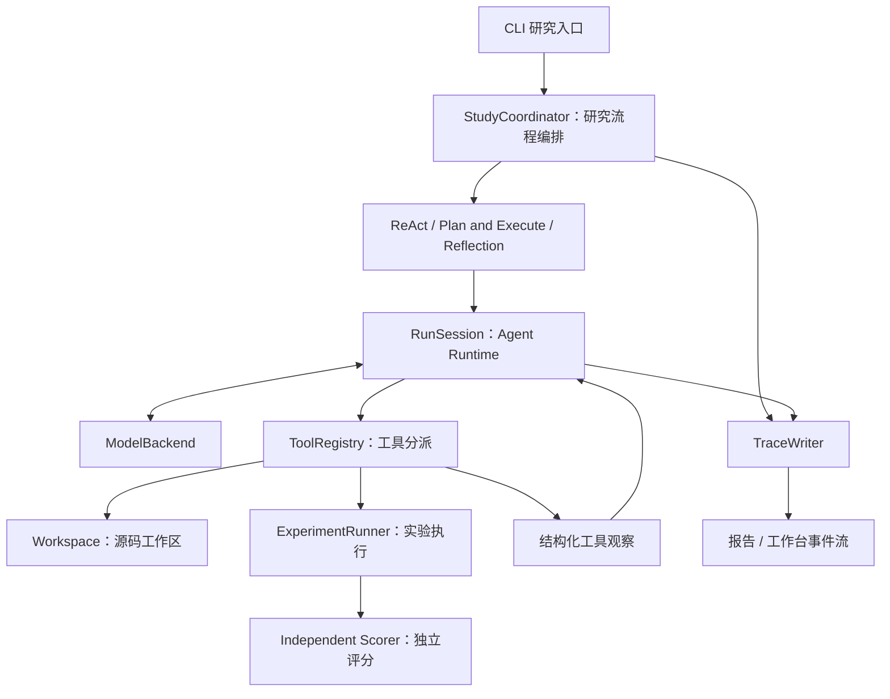
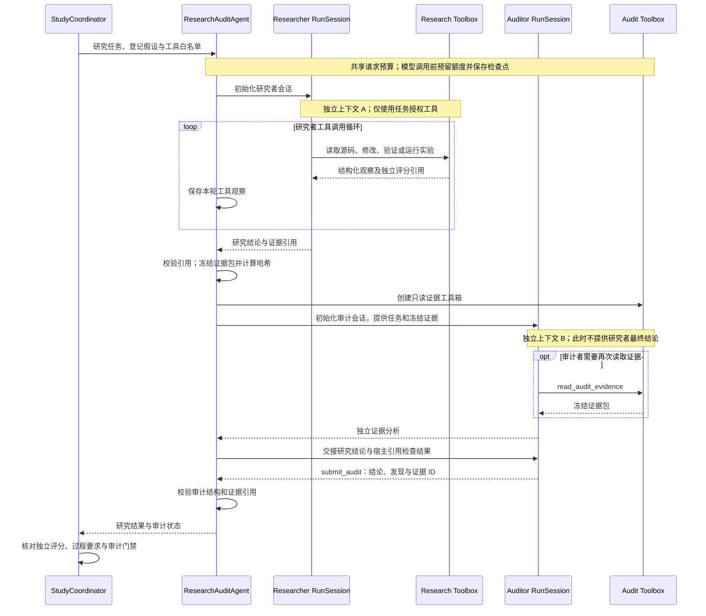

# RecLab Agent

一个面向推荐模型优化的研究 Agent：在固定数据、评估协议与资源预算下，读取源码、提出可检验假设、修改代码、运行实验，并根据独立验证集评分决定保留、否定或补充证据。

**研究流程：背景 → 假设 → 实验 → 分析。** 默认使用一个固定随机种子；历史基线通过身份与评分核验后可以复用，无需每次重新训练。

## 核心能力

- **工具化研究闭环**：源码读写、语法检查、Smoke Test、训练、预测、日志与独立评分由宿主工具执行，模型只能使用当前阶段授权的工具。
- **Agent 策略**：支持 ReAct、Plan and Execute、Reflection，复用统一的 Agent Runtime。
- **主研究者 + 独立审计**：两个会话隔离上下文与权限。审计者只读冻结证据，先独立判断再核查研究结论；审计通过不能替代独立评分。默认仍为单 Agent。
- **长期记忆**：通过 SQLite 实验账本和可检索的 Markdown 经验摘要跨会话复用研究信息；默认使用 BM25，数值结论回读原始评分。
- **研究工作台**：查看真实会话、指标提升图、关键改进、代码差异、评分证据、审计结果和事件流；CLI 与 Web 共用状态。
- **资源预算**：限制模型请求、补丁与训练尝试；重试、格式纠正和失败请求共享原额度。
- **故障恢复**：持久化检查点与预算，核对已登记作业；工具副作用不明时要求状态核验。

## 架构与关键设计

### 1. Agent Runtime

- **问题**：不同 Agent 策略重复实现消息管理、工具调度和结果处理，扩展时容易出现行为不一致。
- **方案**：以 [`RunSession`](reclab_agent/core/session.py) 实现统一运行时，管理单次运行的消息历史、原生工具调用、观察结果回填与结构化返回；通过 `ModelBackend` 和 `Toolbox` 接口接入模型与工具。
- **优点**：策略与执行机制解耦；更换模型、扩展工具或新增策略时，可以复用同一个运行内核。

### 2. Agent 策略：ReAct、Plan and Execute、Reflection

**问题**：探索式任务、可分解任务和答案修订任务需要不同的决策方式，单一调用流程难以兼顾。

**方案**：策略通过统一的 `Agent.run()` 接口接入 Runtime。下表中的配置值对应 `task.mode`：

| 模式 | 执行流程 | 适用场景与优点 |
|---|---|---|
| **ReAct**（`single`） | 根据当前上下文选择动作 → 调用工具 → 读取观察 → 决定下一步 | 适合需要根据源码、日志和实验反馈逐步探索的任务；每一步都可以利用新证据 |
| **Plan and Execute**（`plan_execute`） | 生成结构化计划 → 顺序执行子任务 → 综合结果 | 适合可提前拆分的任务；显式记录计划及各步骤结果，便于检查任务覆盖情况 |
| **Reflection**（`reviewer`） | 生成初稿 → 结构化自评 → 根据反馈修订，次数有界 | 适合检查证据遗漏、无依据表述与答案完整性；保留反馈与修订状态 |

**优点**：可以在相同工具接口下切换策略，并对不同决策流程做对照。Plan and Execute 当前为顺序执行；Reflection 为单 Agent 自评，最终修订稿可能尚未再次自评，结果中单独记录 `review_approved`。

实现与接口见 [Agent 框架说明](docs/agent-framework.md)。

### 3. Workflow Orchestration：研究流程编排

- **问题**：自由工具调用可能跳过假设登记、必要验证或结果分析，使研究过程缺少约束。
- **方案**：[`StudyCoordinator`](reclab_agent/workflow/coordinator.py) 管理背景、假设、实验、分析四个阶段；Agent 在当前阶段内选择动作。背景阶段先解析或建立基线，后续登记假设、执行候选实验并分析结果。
- **优点**：阶段转换可检查，研究步骤可追溯；可核验的历史基线能够复用，避免强制重复训练。

### 4. Tool Abstraction：工具抽象与 Function Calling

- **问题**：模型调用协议与业务代码直接耦合，会增加工具扩展和接口维护成本。
- **方案**：通过 `ToolSpec` 描述工具名称、参数 schema 与用途；`ToolRegistry` 注册工具或包装既有函数，统一按名称分派，并返回结构化结果或错误。业务能力按源码、实验、评估、知识等类别组织在 `tools/`。
- **优点**：工具可以独立注册、组合和测试；模型通过原生 Function Calling 请求能力，业务实现不依赖自由文本动作解析。

接口与职责见 [tools 说明](reclab_agent/tools/README.md)。

### 5. Tool Authorization：工具授权与权限控制

- **问题**：仅依赖 Prompt 约束，无法阻止越权工具请求、修改未授权文件或绕过研究阶段。
- **方案**：运行时按白名单过滤模型可见的工具，并在执行分派前再次检查权限；业务工具进一步校验研究阶段、登记计划、允许路径和源码哈希。
- **优点**：权限由宿主代码执行，模型输出不会自动扩大授权范围；非法调用可以被拒绝并记录。这里的能力隔离属于应用层权限控制，不等同于操作系统沙箱。

### 6. Long-term Memory：长期记忆

- **问题**：研究会话结束后，基线、失败尝试和有效经验容易丢失；把全部历史对话直接加入上下文又会增加噪声。
- **方案**：使用 **SQLite 实验账本（Experiment Ledger）**保存结构化实验记录与比较范围，使用 **Markdown 经验摘要**保存可检索知识；默认通过 BM25 按范围召回，源码快照和原始评分作为证据来源。
- **优点**：跨会话复用基线与研究经验，限制不兼容经验混用；经验摘要辅助提出假设，数值结论仍可追溯到原始评分。

使用方式见 [项目记忆与研究运行](docs/research-usage.md)。

### 7. Multi-Agent Collaboration：主研究者与独立审计

- **问题**：同一个 Agent 同时提出修改和评价自身结论，容易沿用先前假设，缺少独立复核步骤。
- **方案**：主研究者与审计者使用独立 `RunSession` 和工具权限。宿主冻结工具观察；审计者先独立分析证据，再接收主研究者结论。审计者只读证据，不能编辑源码、启动训练或增加预算；引用与审计输出由代码校验。
- **优点**：将候选提出与证据复核明确分工，形成可追溯的审计记录；审计未通过或证据不足时可以阻止候选被接受。是否提高整体成功率由单／多 Agent 对照验证，当前未证明多 Agent 普遍更优。

协议、Prompt 与对照结果见 [独立审计说明](docs/research-audit.md)。

### 8. Budget Management：资源预算管理

- **问题**：模型重试、格式纠正和多 Agent 调用会增加实际消耗；仅统计成功轮次会低估请求数。
- **方案**：区分模型轮次与实际请求，在研究协调器和审计策略中于调用前持久化预留请求额度；重试、格式纠正和已尝试的失败请求共享原预算，补丁与训练尝试另有额度限制。
- **优点**：角色切换和重试不会获得额外额度，资源用量可以核对。货币费用仍依据显式价格表及已报告用量估算，不把请求上限描述为实际账单保证。

### 9. Checkpointing and Recovery：检查点与故障恢复

- **问题**：控制器中断后，重新运行可能重复训练、丢失已消费额度，或把未知工具结果误当作失败后直接重试。
- **方案**：原子写入会话及审计检查点，绑定任务、模型、权限、Prompt 和证据身份；恢复已保存阶段与预算，并核对已登记的远端作业。工具副作用不明时进入 `reconciliation_required`，先做状态核验。
- **优点**：支持在身份一致时继续已有流程或复用已知作业，控制重复执行风险。会话恢复、远端作业复用与模型 checkpoint 续训分别处理，不承诺任意故障下的恰好执行一次。

恢复验证见 [可观测与恢复边界](docs/observability.md)。

### 10. Evaluation Framework：分层评测体系

**问题**：Agent 能完成对话、修好代码或找到证据，并不直接说明推荐模型质量改善，需要分别验证。

**方案**：为不同能力设置独立任务、指标与评分方式：

| 评测层次 | 评测对象 | 评分方式 |
|---|---|---|
| **推荐模型评估** | 候选模型效果 | 固定协议下独立计算验证集 NDCG / Recall，核对比较身份、护栏与过程要求 |
| **Agent 诊断评测** | 读取实验记录后的决策与引用 | 冻结标准答案，由代码检查完成状态、JSON 格式、决策与引用 |
| **Coding Evaluation** | 实际代码修复 | 检查真实源码变化，并执行公开与隐藏 CPU Docker 用例 |
| **Retrieval Evaluation** | 相关证据召回 | 在标注段落上计算 Recall@K、MRR 与延迟 |

**优点**：定位具体能力缺口，区分服务失败、协议失败与任务失败；报告和提升图复用同一套资格判断，不将无评分实验记为零分，也不把合成诊断成绩当作端到端研究收益。

实际结果与适用范围见下文“评测体系与已验证结果”。

### 11. Observability：可观测性

- **问题**：长流程涉及多个阶段、角色和实验，仅看最终答案难以定位失败原因及实际消耗。
- **方案**：以 `study_id / run_id / parent_run_id` 关联研究与子运行，记录阶段、角色、候选、实验、UTC 时间和事件序号；模型请求记录请求 ID、耗时、用量、错误类别及 Prompt 内容哈希，工作台通过 SSE 读取持久事件。
- **优点**：能够沿同一证据链定位模型请求、工具调用和实验产物，区分服务异常与研究判断问题，并支持事件重连和问题复盘。

字段定义见 [Trace 与事件说明](docs/observability.md)。

### 单 Agent 调用关系



### 多 Agent 调用关系

`research_audit` 由 `ResearchAuditAgent` 串行协调主研究者和独立审计者。下面的时序图展示两套 Runtime 的交接顺序与权限边界：



- **上下文隔离**：两者分别维护消息历史，审计者先完成独立分析，再查看研究者结论。
- **权限隔离**：研究者使用当前阶段授权的业务工具；审计者只能读取冻结证据，不能编辑或启动实验。
- **资源约束**：两者共享宿主维护的请求额度，切换角色和协议纠正不会重置预算。
- **结果门禁**：审计结果是候选接受条件之一，推荐指标仍由独立评分器计算。协议错误、拒绝或证据不足不会因运行结束而被视为通过。

这是顺序执行的研究与审计流程，不包含并行候选训练；两个会话可以使用同一个模型后端，独立性来自上下文、证据交接和权限边界。


*截图使用隔离的界面验收示例，不代表真实模型收益。图中只有已核验、可比较且满足全部门禁的候选才进入最佳曲线；失败不填零分。*

## 快速开始：无需 GPU

需要 **Python 3.10+**。在仓库根目录执行：

```bash
python -m pip install -e ".[service,test]"
python -m reclab_agent.cli.web --root . --port 8000
```

访问 **http://127.0.0.1:8000**。Windows 也可使用启动器准备或复用 Web 环境：

```powershell
.\start.cmd -Web
```

打开页面不会启动训练。可以先点击“运行本地证据演示”，检查工具、报告和事件是否正常；默认 Web 未装配训练执行器，登记任务会等待配置。真实研究从 CLI 启动，工作台读取相同的本地会话。只允许取消尚未执行的等待任务。

命令行也可以进行零模型调用的检查：

```bash
python -m reclab_agent
python -m reclab_agent.cli.research runs list
python -m reclab_agent.cli.evaluate retrieval --modes bm25
python -m reclab_agent.cli.evaluate diagnostics --manifest tasks/diagnostic-v2/diagnostic-dev.json --output reports/local-diagnostic-reference.json
```

第一条执行 15 项证据工具参考调用；诊断命令默认使用确定性参考规则。它们都不是端到端 Agent 成功率。

## 运行真实研究

默认任务由 [reclab.json](reclab.json) 指定。先配置并审阅任务，再启动：

| 配置 | 用途 |
|---|---|
| [任务配置](configs/beauty-sasrec-task.json) | 模型、数据、指标、允许修改的文件、执行环境与预算 |
| `.reclab/agent.env` | 本地模型 API 配置；不进入 Git |
| `configs/autodl-ssh.json` | 本地 SSH 连接配置，参考 [example](configs/autodl-ssh.example.json)；不进入 Git |
| `task.mode` | 默认 `single`；独立审计设为 `research_audit`；另有 `plan_execute` 和单 Agent 自评 `reviewer` |

```powershell
.\start.cmd -Plan
.\start.cmd
```

真实 Agent 需要模型 API，当前 SASRec 任务还需要已配置的远程训练环境。API、文献搜索和 GPU 可能产生费用，应先检查任务预算。Linux/WSL 的启动参数见 `python -m reclab_agent.start --help`。

`reviewer` 是单 Agent 自评，不能当作独立审计；旧 `team` 模式已移除。独立审计共享请求预算，使用结构化提交与有界格式纠正。其原理、权限和恢复边界见[独立审计说明](docs/research-audit.md)。

每次研究保存源码快照、实验与作业记录，以及 `report.json`、`report.md`、`report.html`。失败、负结果和证据不足都会保留。新工作树不会自动带入原目录中被忽略的权重、数据或本地会话；评分文件缺失时，界面不会补造“已核验提升”。

## 评测体系与已验证结果

| 层次 | 评测方法 | 当前证据与边界 |
|---|---|---|
| 推荐模型效果 | 固定协议下独立计算验证集 NDCG / Recall，比较兼容基线与候选 | SASRec dropout 候选两项指标下降，保留基线；GRURec 完成迁移基线，见 [GPU 验收](reports/gpu-acceptance-20261123.md) |
| Agent 决策与引用 | 冻结合成证据任务，检查完成状态、JSON、决策与引用 | 最新同快照开发集：单 Agent **28/30、64 次请求**；独立审计 **27/30、124 次请求**，见 [完整对照](reports/paired-role-prompts-combined-20261124.md) |
| 编码能力 | 冻结小型任务、真实补丁、公开与隐藏 CPU Docker 检查 | 衡量限定范围内的功能修复，不代表真实推荐收益或一般仓库修复能力 |
| 检索质量 | 标注段落的 Recall@K、MRR 与延迟 | 支持 BM25、dense、hybrid、reranked；小语料实验没有证明重排一定改善效果 |
| 工程与成本 | 离线回归、HTTP/SSE、恢复测试、请求与 Token 统计 | 费用仅按显式价格表和已报告用量估算，不等同于服务商账单 |

最新单／多 Agent 对照仅包含 30 个开发诊断任务，未包含完整研究流程、真实训练、编码或最新冻结集。未通过案例为 API 连接错误或超时；不同时间窗口的服务状态会影响结果，不能据此声称独立审计优于单 Agent。审计模式的通用收益仍需更多错误决策样本与对照实验。

模型候选被接受还需要护栏不下降、必需过程诊断满足要求；启用独立审计时必须审计通过。当前验证集也参与 checkpoint 与候选选择，单种子结果不代表独立测试集收益或统计显著性。原生 SSH/tmux 验收不等同于云端 Docker/GPU 隔离，也未证明所有中断点均能自动恢复。

## 测试与复现

```bash
python -m unittest discover -s tests -q
python -m unittest experiments.strategy_comparison.test_comparison experiments.strategy_comparison.test_runner experiments.strategy_comparison.test_tools -q
node --test tests/frontend/*.test.cjs
```

前端逻辑测试需要 Node.js；核心工具使用标准库，Web 测试需要安装 `service,test` 可选依赖。可选文本模型另需 CPU PyTorch 与 `retrieval` 依赖，默认只读本地缓存，显式 `--download-models` 才允许下载。

整合验收记录见[工作台验收](reports/workbench-acceptance-20261124.md)。界面覆盖桌面与窄屏、图点详情、实验表、事件筛选、任务登记和取消；截图与使用方法见[工作台说明](docs/workbench-design.md)。

2026-11-24 整合验收：**551 项主测试（543 通过、8 跳过）、37 项策略实验测试及 17 项前端逻辑测试通过**；112 个包内 Python 文件语法检查通过。

## 项目结构与文档

```text
reclab_agent/
  application/    CLI / Web 共用的任务入口与状态视图
  workflow/       四阶段研究协调与资源约束
  agents/         单 Agent 策略、主研究者与独立审计
  tools/          按能力组织的工具与工具箱
  core/           模型交互、会话、权限与 Trace
  experiments/    实验工作区、基线、诊断与结果比较
  execution/      本地 / 远程执行器与作业管理
  memory/         实验账本、经验摘要与检索
  evaluation/     排序、诊断、编码、检索和成本评测
  reporting/      独立证据核验、可读报告与提升序列
  web/            研究工作台页面与静态资源
```

- [文档导航](docs/README.md) · [架构与代码导航](docs/architecture.md) · [工具职责](reclab_agent/tools/README.md)
- [研究运行、基线复用与项目记忆](docs/research-usage.md) · [独立审计](docs/research-audit.md) · [可观测与恢复边界](docs/observability.md)
- [本地功能与验收](docs/non-gpu-work.md) · [工作台使用](docs/workbench-design.md) · [仓库优化记录](docs/optimization-log.md)
- [功能需求](docs/plan.md) · [实施方案](docs/implementation-plan.md) · [最初八周计划](docs/eight-week-plan.md)
