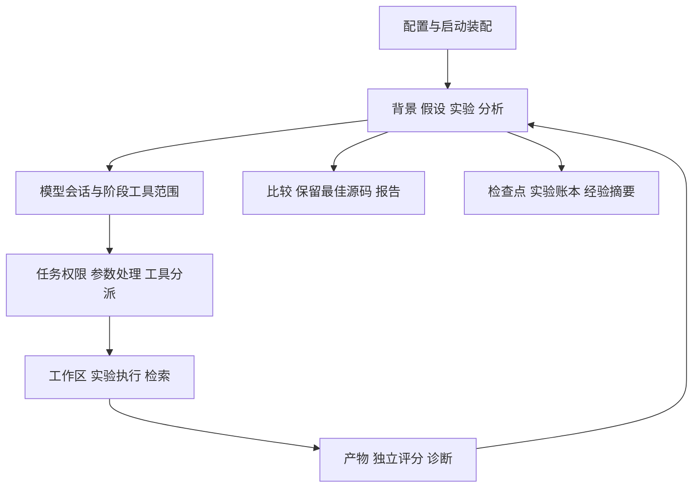

# RecLab 四天面试准备

日期：2026-11-24 至 2026-11-27。每天净投入 8 小时，休息另计；11 月 28 日开始投递。数学 SFT/GRPO 路线暂停，本轮围绕现有 RecLab 的代码、实验和独立解释能力展开。

验收目标：把项目打磨成稳定、可复现、能讲透的面试作品。前两天集中修复代码和完善评测，后两天完成展示与面试准备。能在五分钟内说明系统，沿一次工具调用定位代码，解释一项真实修复、实验失败及适用边界。计划与实际进度分开记录，不把文档写入视为学习或验收完成。个人笔记和录音建议保存在本地 `.reclab/interview-prep/`。

## 四天安排

| 日期 | 时间分配 | 当天交付 |
|---|---|---|
| 11 月 24 日 修复真实问题 | 失败审计 1h；复现用例 1h；局部修复 2h；回归 1.5h；证据与文档 1h；代码解释及复盘 1.5h | 七例失败归因、原始输出与结构化错误、预算不重置的验证、实际 Diff 与测试 |
| 11 月 25 日 补齐评测与复现 | 编码输入契约与公开示例 2h；新协议冻结 1h；修复路径复核 2h；有请求上限的小规模验收 1h；必要回归及说明 2h | 单独版本化的新协议、保留的旧成绩、新报告和可复现命令 |
| 11 月 26 日 完成展示材料 | 亲自运行修复链路 2h；连续演示录制 2h；架构图 1.5h；安装运行说明 1.5h；材料复核 1h | 三至五分钟连续演示、架构图、从安装到运行的说明及证据索引 |
| 11 月 27 日 面试与投递准备 | 定向简历 1.5h；关键代码走读 2h；五分钟讲稿 1h；模拟面试 2h；岗位清单及复盘 1.5h | 可投递简历、讲稿、至少一轮模拟面试和首批岗位清单 |

第 3 天结束后冻结功能范围。第 4 天以交付和面试为主。现有 GPU 实验作为证据复核；新增调用或训练另行配置预算，不重置旧会话额度。局部修复只做必要回归；协议变化后使用新版本和报告，不覆盖冻结成绩。

## 今天的八小时

| 开工后时间 | 任务 | 完成标准 |
|---|---|---|
| 00:00–01:00 | 对照冻结报告、Trace 和角色检查点分析七个失败 | 分清格式、角色终止、服务超时与错误判断，不把所有失败都归因于代码 |
| 01:00–02:00 | 固化实际错误输出，并写确定性复现用例 | 离线重现错误归因和缺失字段问题，模型的解释文字仍按严格协议拒绝 |
| 02:00–04:00 | 修复错误归因、原始响应追踪、角色结果校验和预算拒绝记账 | 非法输出成为明确终态；失败请求保留额度；请求未送出不当作 API 使用量 |
| 04:00–05:30 | 跑相关测试，再做全量回归与打包检查 | 有实际执行结果；不以模拟测试宣称模型在线能力改善 |
| 05:30–06:30 | 保存失败审计和修改说明，明确新旧报告身份 | 原有 23/30 报告不改写，新错误归因策略不能覆盖旧报告 |
| 06:30–07:30 | 亲自走读本次 Diff，解释两个修复和一个未修复的模型错误 | 能指出触发条件、相关代码、修复取舍和测试作用 |
| 07:30–08:00 | 复盘，列出第二天的输入契约、公开示例和验收任务 | 形成下一步清单，读代码与基础学习服务于实际修复 |

## 阅读顺序与代码位置

| 顺序 | 文件 | 需要回答的问题 |
|---|---|---|
| 1 | [启动装配](../reclab_agent/application/launch.py) | 配置、模型、工具和 runner 如何装配？ |
| 2 | [四阶段协调器](../reclab_agent/workflow/coordinator.py) | 哪些步骤由确定性代码控制，哪些交给模型？候选结束后为何恢复最佳源码？ |
| 3 | [工具组合](../reclab_agent/tools/toolbox.py)与[共享状态](../reclab_agent/tools/context.py) | 工具何时注册？阶段、预算、实验和 pending 如何保存？ |
| 4 | [通用会话](../reclab_agent/core/session.py)与[注册表](../reclab_agent/tools/registry.py) | 注册工具为何不等于授予任务权限？模型调用与实际执行在哪里连接？ |
| 5 | [工作区](../reclab_agent/experiments/workspace.py)与[实验工具](../reclab_agent/tools/experiments.py) | 可编辑文件、源码哈希、补丁和实验身份如何约束？ |
| 6 | [本地实验流程](../reclab_agent/experiments/runner.py)与[远程实验流程](../reclab_agent/experiments/remote_runner.py) | 训练、预测、独立评分如何串联？恢复为何要核验原作业？ |
| 7 | [项目记忆](../reclab_agent/memory/project.py) | 实验事实、已接受方案、Wiki 和可检索经验分别怎样存储？ |

这张图用于解释依赖关系，不表示本地 CPU Docker 与远端 SSH/tmux 具有相同隔离能力。基线通过工具解析，有兼容的已核验历史记录时可以复用；新任务需要时先建立基线，再开展候选假设与实验。

## 可用于代码走读的独立练习

在本地练习目录实现一个最小调度器，输入工具名称、参数与本次任务允许调用的名称集合，返回结构化结果。只使用内存里的简单处理函数，专注调用边界。

建议验证以下五类情况：

1. 合法工具、合法参数，返回正确结果。
2. 名称不存在，返回明确错误。
3. 参数不是对象，返回明确错误。
4. 已注册但不在任务允许范围，处理函数调用次数保持为零。
5. 处理函数出现预期业务错误与意外程序错误时，能够说明哪些应回传模型、哪些应暴露给开发者。

可在第 4 天代码走读时先独立写，再与 [core/session.py](../reclab_agent/core/session.py)、[tools/registry.py](../reclab_agent/tools/registry.py)、[现有注册表测试](../tests/test_tool_registry.py)和[会话测试](../tests/test_agent_core.py)对照。练习完成不等于生产缺陷修复；修复记录必须包含真实触发条件、实际 Diff 和必要测试。

## 可用于讲解的已有证据

| 主题 | 已有事实 | 证据与边界 |
|---|---|---|
| 编码修复闭环 | recent_history-2 的公开检查从 1/3 变为 3/3，隐藏检查 24/24 | [有序工具记录与 Diff](../reports/coding-repair-evidence-20261124.json)；四类合成功能任务之一 |
| 推荐实验负结果 | SASRec dropout 从 0.4 调为 0.15 后，NDCG@20 从 0.0804503 降至 0.0774193，保留基线 | [GPU 报告](../reports/gpu-acceptance-20261123.md)；单种子验证集，非普遍收益证明 |
| 模式对照 | 冻结合成诊断单 Agent 26/30，多角色 23/30；编码分别 3/8、6/8 | [非 GPU 报告](../reports/non-gpu-acceptance-20261124.md)；场景相关、样本小、上限相同但实际消耗不同 |
| 检索取舍 | 小语料上重排变差，默认保留 BM25 | [检索记录](non-gpu-work.md)；引用定位不等于每句结论都得到事实支持 |
| 恢复 | 控制器中断后远端训练保留，核验身份后复用原作业 | [恢复记录](../reports/gpu-acceptance-20261123.md)；首次恢复需要人工核验，非全部故障点自动恢复 |
| 测试与打包 | 512 项主测试中 504 通过、8 跳过，37 项策略测试通过 | [验收汇总](../reports/non-gpu-acceptance-20261124.json)；是已有版本记录，不是新增修改已验证的证明 |

## 三分钟讲解底稿

RecLab 面向推荐模型的实验优化任务，把读取源码、提出假设、执行实验和分析结果连接起来。难点是让模型提出的修改成为可追溯、受约束、能够独立核验的实验。

系统用确定性的四阶段协调器管理研究顺序，通过 Function Calling 暴露工具。工具在 tools 下按能力组织；实际工作区操作、实验执行、记忆和评分由各自模块负责。注册能力与任务权限分开，源码修改还要经过文件范围与哈希检查。

实验链路保存源码快照、配置、作业身份和产物，再从逐用户预测独立计算验证指标。历史基线兼容时可以复用。失败和缺失证据有明确状态，模型的文字结论不能替代评分事实。

跨会话信息分为检查点、结构化实验账本和可检索经验摘要。检查点用于恢复执行，账本保存实验事实，摘要用于检索线索；关键数字仍回读原始产物。

真实验收保留了负结果：SASRec dropout 候选没有改善，因此保留基线。另有一次小型编码修复从公开检查 1/3 变为 3/3，并通过隐藏检查。多角色在不同任务上的结果并不一致，当前默认仍为单 Agent。

当前边界包括云端 GPU 容器隔离、所有故障点自动恢复尚未验证，合成评测也不代表一般研究能力。讲解时另行说明自己参与的设计、编码与验证范围，以及辅助工具的使用方式，不把已有仓库成果全部描述为独立手写。

## 今天的五个追问

1. 四阶段流程与通用 Agent 工具循环分别负责什么？
2. 模型请求了已注册但未被任务授权的工具，在哪里阻止执行？
3. 检查点、实验账本、经验摘要分别解决什么问题？
4. 为什么候选训练成功、会话 completed，并不等于候选可以接受？
5. 已有测试、合成诊断与真实推荐实验各能证明什么，不能证明什么？

## 进度记录

11 月 24 日已完成[第一天代码修复与离线审计](../reports/day1-failure-audit-20261124.md)：七例历史失败已分类，四条实际输出固化为 fixture，新增九项回归用例。个人代码走读、讲解和后续三天交付仍按下列清单验收，不能因维护者已修改代码就视为个人掌握。

- [ ] 第 1 天：真实失败复现、局部修复、回归及个人代码解释。
- [ ] 第 2 天：输入契约、新协议冻结、小规模验收与复现。
- [ ] 第 3 天：连续演示、架构图及安装运行说明。
- [ ] 第 4 天：材料定稿、连续演示、模拟面试和投递准备。

只有实际完成对应任务后再勾选；任务未完成时记录阻碍与现有结果。第 5 天按照实际完成内容开始投递。
