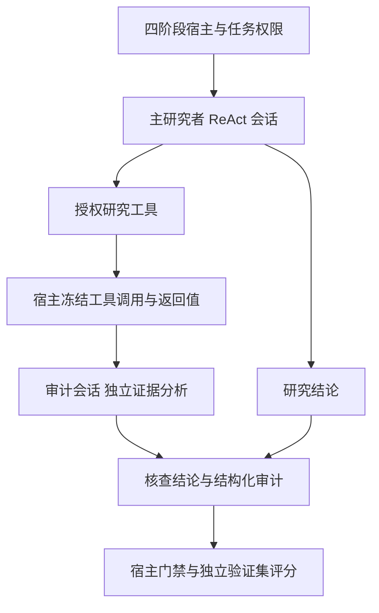

# 主研究者与独立审计

`research_audit` 使用两个独立模型会话，嵌入现有四阶段研究流程。默认仍是 `single`。最新固定快照开发集已补齐：单 Agent 28/30，多 Agent 27/30，见[完整报告](../reports/paired-role-prompts-combined-20261124.md)。历史 [v2 报告](../reports/research-audit-v2-live-20261124.md)和 [v1 报告](../reports/research-audit-live-20261124.md)使用各自协议，不能直接比较成绩。

## 角色 Prompt 与评测任务说明

实际研究者、审计者及各阶段交接的英文 Prompt 集中在 [research_audit_prompts.py](../reclab_agent/agents/research_audit_prompts.py)，由 [协作策略](../reclab_agent/agents/research_audit_agent.py)装配。它们按角色、任务、要求、输出和具体示例分段，没有省略号占位内容。最新整理版已通过离线验证，并在固定源码快照上完成单、多 Agent 开发评测。多 Agent 首轮仅覆盖 3 例，后续只补齐未运行的 27 例，没有重跑单 Agent 或任何已尝试案例。上文 v1、v2 链接属于历史提示词版本。

诊断评测的 [任务说明](../reclab_agent/evaluation/diagnostics.py)是交给被测 Agent 的题目要求，不是评分模型。评分由 Python 根据冻结答案、引用与完成状态进行。角色 Prompt 属于被测系统，任务说明、数据和评分规则属于评测协议，应分别管理。

- 自建开发评测可以修改说明以消除歧义，但必须形成新版本，所有待比较模式使用相同说明。
- 固定对照时，保持任务说明、数据、评分、模型配置和预算一致，只改变希望研究的 Agent 部分。
- 已冻结或官方给定的评测，应按其原说明运行；改写后的结果属于自定义协议，不能直接当作原协议成绩。
- 新增换行、格式示例或引用提示也可能影响模型表现，不能默认没有影响。

核对发现，历史 v1 与 v2 真实报告的任务 `prompt_hash` 不同。因此此前同一 13 例的分数差异只能作为各自协议下的开发观察，不能全部归因于 Agent 修复。本次没有再次修改评测任务说明。角色 Prompt 另以 `role_prompt_hash` 绑定检查点、评测身份和研究报告，改变角色提示词时须使用新报告，不覆盖历史记录。

本次只整理 Prompt；引用纠正仍要求完整 JSON 重提交，未改成引用补丁，预算与权限规则保持原状。

### 固定快照首轮：历史部分覆盖

两种模式计划各测开发集 30 例，每例最多 8 次请求，总上限 480 次请求、50 分钟；模型、任务 Prompt、案例、评分策略和输出上限一致。源码及任务先复制到 `.reclab/evaluation-snapshots/paired-role-prompts-20261124`，凭据留在快照之外；运行结束核验 119 个文件均未改变。

单 Agent 实际尝试 30 例，通过 28 例，64 次请求，失败为一次服务错误、一次超时。多 Agent 实际尝试 3 例，通过 2 例，10 次请求，第三例为服务错误；剩余 27 例因总截止时间未发出请求。本轮实际请求数合计 74，与 Trace 一致，未使用 GPU。

顺序执行共享总时限导致后执行模式覆盖不足，属于评测安排的局限。不能把原始多 Agent 报告中的 2/30 当作能力成绩，也不能据此宣称两种模式优劣。后续应只补测未运行的多 Agent 案例，保留已发生的服务失败，不重跑单 Agent。即使补齐，本轮比较的也是两套配置的整体表现，不能单独识别审计角色的因果贡献。

### 补测完成：两种模式均覆盖 30 例

沿用首轮同一份 119 文件快照、完整 30 例开发集、任务及角色 Prompt、模型与评分规则，仅选择没有实际 API 请求的案例。两个新增窗口分别尝试 21 例（19 例通过、87 次请求）和 6 例（全部通过、27 次请求）；窗口时限分别为 50 和 20 分钟，累计新增 114 次请求，未超过原定新增上限 216 次。未使用 GPU。

补测 27 例中 25 例通过，`missing_score-3`、`missing_score-4` 因 APIConnectionError 失败。保留首轮 3 例（2 例通过、1 例服务失败）后，多 Agent 共 27/30、124 次请求。单 Agent 保留首轮 28/30、64 次请求，没有重跑。原始报告保留，合并报告是已有证据的派生汇总，不是额外一次运行。

多 Agent 最终答案没有 JSON 格式失败；审计协议格式纠正触发 1 次并成功。当前失败集中在服务错误与超时，没有足够错误决策样本验证审计拦截收益；不同时间窗口的服务状态也会影响比较。见[合并报告](../reports/paired-role-prompts-combined-20261124.md)和[来源核验](../reports/paired-role-prompts-combined-20261124-verification.json)。

## 运行方式

在任务 JSON 中设置：

```json
{"task": {"mode": "research_audit"}}
```

这是现有配置的字段片段，需要保留其他必填字段。启动命令与普通研究相同，见 [研究使用说明](research-usage.md)。诊断入口也可选择：

```bash
python -m reclab_agent.cli.diagnostics --agent research_audit --model YOUR_MODEL --ask "读取指定实验的验证集证据，分析是否支持候选结论" --trace traces/research-audit.jsonl
```

这条命令会调用真实 API。离线回归无需 API 或 GPU：

```bash
python -m unittest tests.test_research_audit_agent tests.test_local_evaluation -q
```

## 上下文与权限

| 项目 | 主研究者 | 独立审计者 |
|---|---|---|
| 会话 | 独立输入、模型输出和工具消息 | 独立输入、模型输出和工具消息 |
| 初始输入 | 宿主研究上下文、当前任务 | 当前任务、冻结证据及授权范围 |
| 可见工具 | 当前阶段与任务允许的研究工具 | `read_audit_evidence`，只返回冻结证据 |
| 修改与执行 | 仍受文件、候选、预算及阶段限制 | 无编辑、训练、停止作业、网络及任意文件读取权限 |
| 结论 | 根据证据提交研究结论 | 先独立分析，再接收研究结论进行审核 |
| 最终权限 | 不能自行改变评分规则 | 不能授权新实验、扩大预算或代替独立评分 |

隔离由宿主传递不同 `RunSession` 和不同工具箱实现，不只依赖 Prompt。审计工具箱不包含研究工具的处理函数。即使模型猜出 `run_experiment` 或编辑工具名称，执行边界也会拒绝；最终的 `submit_audit` 仅解析为数据，不执行函数。

这是模型上下文和工具能力的隔离，两个会话仍运行在同一宿主进程，不是操作系统或容器安全隔离。默认可复用同一模型服务；Python 调用方可以向 `ResearchAuditAgent(..., audit_backend=...)` 注入另一模型。更换模型本身不保证审计质量，不依赖 Jev。

## 证据交接与结论



证据包包含原任务、授权工具名及带 `e1`、`e2` 等编号的实际工具调用和返回值，并计算内容哈希。包不包含主研究者会话、推理或最终结论；审计完成第一轮独立分析后，才收到结论。两个会话分别保存，主研究者也不会收到审计者的内部会话。

审计者目前只检查已捕获的证据，不会重新读取活动工作区。这样避免任意路径访问及审计期间证据变化，但主研究者遗漏的源码、日志或诊断可能导致证据不足。工具证据的真实性仍依赖宿主工具、评分器和产物身份校验；冻结及哈希不能证明证据完整或推断正确。产物内的指令按不可信数据处理。

审计输出包含 `verdict`、`findings`、`summary`；发现项使用证据编号引用。

当前为协议 **v2**。宿主严格解析 JSON 并校验字段和证据编号，不自动删除标点或猜测模型原意。第一次提交不合法且有剩余额度时，宿主反馈具体错误，允许最多一次纠正；第二次不合法或额度不足则返回失败。函数形式的错误提交会得到对应 `call_id` 的错误结果，纠正不会派发业务工具。原始提交和错误保留在会话、检查点及 `audit_protocol_error` Trace 中。

研究者如果提交带 `citations` 的 JSON，宿主在审计前用 `tools/citation_validation.py` 检查路径和 JSON Pointer，只认可 `read_json_values` 已返回的值及子树，不读取新文件。根节点是 `""`，`"/"` 指向空字符串键；不会把二者自动互换。未知路径、不存在的字段、非法转义及冲突的观测值都会失败。

引用不合法时，最多允许一次无工具的纠正，只能修改 `citations`，其他字段必须保持原值。没有足够的研究额度或纠正仍失败，返回 `invalid_citations`，审计无法批准放行。引用检查结果在独立分析完成后才交给审计者，不进入盲审证据包。普通自由文本不适用这项结构化引用检查；引用可以定位也不证明结论受证据支持。

| 审计结果 | Agent 状态 | 含义 |
|---|---|---|
| `approved` | `completed` | 审计通过，仍需满足代码评分与过程门禁 |
| `rejected` | `audit_rejected` | 结论存在问题，保留原结论和审计记录 |
| `insufficient_evidence` | `audit_inconclusive` | 缺少必要证据 |
| 非法字段、虚构编号或非法函数调用 | `invalid_audit` | 审计协议失败 |
| 第一轮未形成独立判断 | `audit_incomplete` | 审计未完成 |
| 结构化引用无效且未能纠正 | `invalid_citations` | 不进入审计、不放行结论 |

本版不自动进入修改或重训循环。宿主在 `research_audit` 模式下将未通过审计的候选设为不可接受；审计通过也不能把验证集指标下降的候选变为改进。报告通过 `audits[candidate_id]` 保存审核结果。

## 预算与恢复

两个会话共享 `max_steps` 请求额度，失败和重试在调用服务前预留，重启不会归零。至少需要 3 次额度，主研究者最多使用总额度减 2 次，为独立分析和最终审核保留额度。真实工具任务通常至少需要 4 次请求：读证据、提交结论、独立分析、审核。

引用纠正、审计协议纠正也消耗同一额度，分别最多一轮，不增加总上限或重置截止时间。纠正次数随检查点持久化。旧版本检查点不能作为 v2 恢复；新评测应使用新报告名称。

状态保存在研究会话文件或 Trace 路径旁的 `.audit.json`，包含分离的会话、冻结证据、阶段、请求计数和结果。恢复时校验任务、模型标识、工具范围、指令及预算；完成的检查点直接返回原结果。工具执行期间中断返回 `reconciliation_required`，需要核实实际状态，不能自动重放可能有副作用的调用。审计模型超时可以恢复未完成审计，但已失败的请求仍占额度。

两个会话的 Trace 以不同 `run_id` 标识，同属一个 `task_id`；`agent_scope` 记录角色和权限，`model_turn.phase` 区分研究、独立分析和最终审核。检查点、Trace 可能包含源码和业务证据，应沿用研究产物的访问控制。

## 代码位置与验证范围

- [协作策略](../reclab_agent/agents/research_audit_agent.py)：独立会话、预算、检查点和证据交接。
- [审计工具与协议](../reclab_agent/tools/audit.py)：只读快照、结构化输出、引用校验。
- [结构化引用检查](../reclab_agent/tools/citation_validation.py)：只根据已观测 JSON 数据定位引用，不访问任意文件。
- [研究协调器](../reclab_agent/workflow/coordinator.py)：候选审计记录与接受门禁。
- [离线测试](../tests/test_research_audit_agent.py)：上下文、越权调用、证据快照、预算、恢复及失败状态。

以下是 **v1 历史真实成绩**。2026-11-24 真实模型回归使用 `qwen3.7-flash`，每例最多 8 次请求、输出最多 2048 token、单请求超时 40 秒且不重试。开发集两种模式均尝试 30 例：单 Agent 29/30、审计模式 20/30，请求数分别为 66、136。审计前有 24 例回答正确且引用达标，最终其中 4 例未放行：两例提交协议失败、一例超时、一例被审计判为证据不足。审计还批准了一例错误决策和三例引用不达标的回答。

本轮到 40 分钟后停止新请求，总请求数 232。冻结集单 Agent 仅运行 12 例，审计模式未发出请求，不作为完整冻结集成绩或配对比较。CPU 编码因原缓存镜像不可用未运行，没有改用宿主执行候选代码。优先修复提交协议、引用与失败归因，复核超时与输出长度，再使用新输出路径和新额度验证。已经分析过的样本属于开发或回归案例，不能视作未见测试；本次结果不支持切换默认模式。

v2 已实现上述协议与引用修复，并用 v1 两条真实非法提交做离线回放。诊断评分现在分别保存 `decision_correct`、`citations_valid`、`citation_located`，错误引用不再抹掉正确决策的记录；所有引用都合法、至少一处满足定位要求及决策正确，仍是通过条件。评分策略标记为 `separate_decision_and_citation_validation_v3`，评测身份绑定协议版本，旧成绩不覆盖。

### v2 单模式真实回归：部分覆盖

本轮仅运行 `research_audit` 的开发集，单 Agent 未新增调用。模型及每例 8 次请求、输出 2048 token、40 秒超时设置保持一致，另设新额度 240 次请求、25 分钟。连续三次服务错误触发原有停止规则后，实际尝试 13 例、通过 6 例，共 51 次请求，剩余 17 例未运行；不能将其视作完整 30 例成绩。

7 例触发引用纠正，解决 0 例：4 例在纠正阶段 API 超时，3 例未通过引用或字段保持校验。6 例完成审计并通过，审计协议重提交未触发，不能据此宣称该纠正分支已经在线验收。已报告输入/输出 token 为 65974/47150，4 次超时缺 usage，未核验账单。

真实记录暴露了纠正提示的歧义，例如模型将字段指针改成 `""/duplicate_source`，以及重提交时改变其他答案字段。后续应给出具体字段错误和可定位指针，并考虑只提交引用补丁，减少整段答案重写；先处理超时，再用独立额度补测未运行任务。本轮没有中途更改实现、放宽规则或补跑失败，也未使用远程 GPU。
